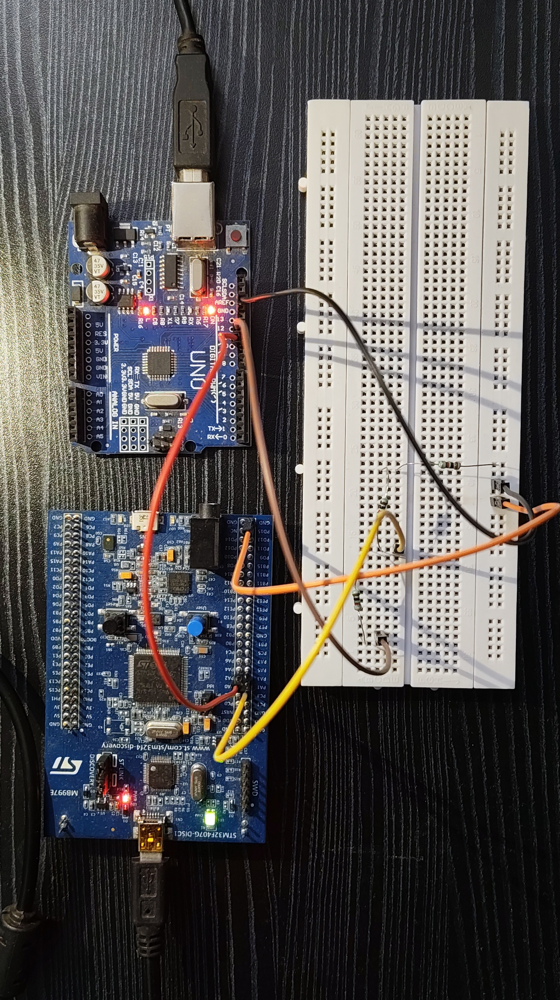
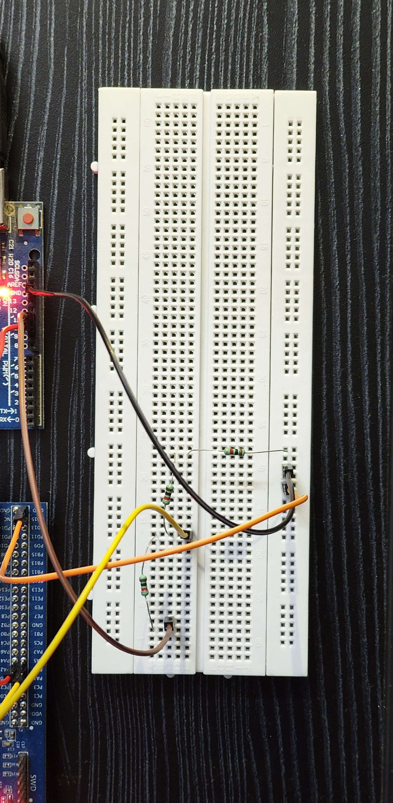
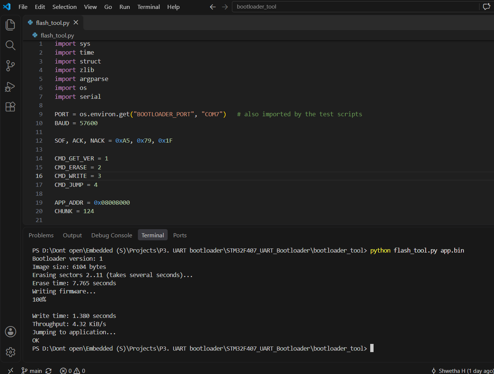

# UART Bootloader for STM32F407 (with an Arduino Uno as the USB-serial bridge)

A small custom bootloader for the STM32F407 Discovery board. It receives a new
firmware image over UART from a Python host tool, writes it to flash, and jumps
to it. Every request packet is protected by a CRC32, and the bootloader refuses to
erase or overwrite itself.

The Discovery board has no USB virtual COM port, so an Arduino Uno is used as the
bridge between the PC and the STM32 UART.

## Demo

<p align="center">
  
  &nbsp;&nbsp;
  
</p>

*Left: hardware setup (Discovery board, Arduino Uno bridge and breadboard). Right: close-up of the breadboard with the 1k / 2k voltage divider between the Uno's TX and the STM32's RX.*

<p align="center">
  
</p>

*Software result: `flash_tool.py` erasing, writing and jumping to the new firmware (6,104-byte image, about 4.3 KiB/s write throughput).*

[Watch the demo video](docs/UART_Bootloader_Demo.mp4): bootloader mode, a UART update, and the new firmware running.

## Results

| Item | Value |
|---|---|
| Bootloader size | 7,336 bytes (7,292 text + 44 data), limit 32 KB |
| Test application size | 6,104 bytes |
| Write throughput | about 4.3-4.4 KiB/s at 57600 baud (roughly 77-79% of the raw line rate) |
| Erase of sectors 2-11 | about 7.7-7.8 s |
| Update of the 6 KB test app | about 9 s total (erase + write, excluding the 2 s wait while the port opens) |
| Failure tests | 15 invalid ERASE/WRITE requests rejected, bad-CRC recovery, bootloader still alive afterwards, all passing |

## Hardware

- STM32F407 Discovery board (STM32F407VGT6)
- Arduino Uno
- 3 x 1 kOhm resistors
- Breadboard and jumper wires

### Wiring

The Uno is a 5 V device and the STM32 pins are 3.3 V, so the Uno-to-STM32 line goes
through a voltage divider (1k on top, 2k = two 1k in series on the bottom, about 3.3 V).

```
Uno D11 (TX) --[1k]--+---- STM32 PA3 (USART2 RX)
                     |
                   [1k]
                     |
                   [1k]
                     |
                    GND

STM32 PA2 (USART2 TX) ------ Uno D10 (RX)
STM32 GND ------------------ Uno GND
```

The STM32-to-Uno direction (3.3 V into a 5 V input) needs no divider.

The Uno runs a small SoftwareSerial bridge sketch (`sketch_nov15a/sketch_nov15a.ino`)
that forwards bytes between the USB serial port (PC) and pins D10/D11 (STM32), both at 57600 baud.

## Flash layout

| Sectors | Address | Size | Use |
|---|---|---|---|
| 0-1 | 0x08000000 | 16K + 16K | Bootloader (32 KB) |
| 2-3 | 0x08008000 | 16K + 16K | Application starts here |
| 4 | 0x08010000 | 64K | Application |
| 5-11 | 0x08020000 | 7 x 128K | Application |

The bootloader is linked at `0x08000000` with `LENGTH = 32K`, so the linker stops
the build if it ever outgrows its area. The application is linked at `0x08008000`
with `LENGTH = 992K`.

## How it boots

1. After reset the bootloader initialises the clocks (168 MHz from the 8 MHz HSE crystal),
   GPIO and USART2.
2. If the blue button (PA0) is **not** held and the application looks valid, it jumps to
   the application. The application's stack pointer must point into RAM and its reset
   vector must point into flash.
3. Otherwise the bootloader stays active, turns the green LED (PD12) on, and waits for
   packets on USART2.

The jump to the application de-initialises the HAL and clocks, stops SysTick, clears the
NVIC, sets `SCB->VTOR` and the main stack pointer, and calls the application's reset handler.

After a successful update the bootloader performs a system reset and lets the normal boot
path start the application, which gives the application a clean peripheral state.

### Application requirements

- Linked at `0x08008000` (`FLASH ORIGIN = 0x08008000`).
- Sets the vector table with `SCB->VTOR = 0x08008000U;` early in `main()`.
- Calls `__enable_irq()` early in `main()` as a safeguard. The bootloader masks all
  interrupts while handing over, and `HAL_Delay` hangs if interrupts are off.

## Protocol

All multi-byte values are little-endian.

```
Request:  [SOF 0xA5] [CMD] [LEN] [PAYLOAD ... LEN bytes] [CRC32 (4 bytes)]
```

The CRC32 is the standard CRC-32 (same as Python's `zlib.crc32`) computed over
`CMD`, `LEN` and the payload. The maximum payload is 128 bytes.

Replies are single bytes: `ACK = 0x79`, `NACK = 0x1F`.

| Command | Code | Payload | Reply |
|---|---|---|---|
| GET_VER | 0x01 | none | ACK, then 1 version byte |
| ERASE | 0x02 | `first_sector`, `count` | ACK or NACK |
| WRITE | 0x03 | 4-byte address + data (multiple of 4 bytes) | ACK or NACK |
| JUMP | 0x04 | none | ACK, then reset and start the app, or NACK if the app is invalid |

A packet with a bad CRC, an oversized length or a timeout is answered with NACK, the
receive buffer is flushed, the red LED (PD14) toggles, and the bootloader keeps listening.

### Safety checks

- ERASE: only sectors 2-11 are allowed (`first >= 2`, `first + count <= 12`, `count > 0`).
  Sectors 0-1, which hold the bootloader, can never be erased.
- WRITE: the address must be word-aligned, at or above `0x08008000`, and the whole
  write must fit inside flash. The range check is written to be safe against
  integer wrap-around (for example an address of `0xFFFFFFFC`).
- WRITE length must be a multiple of 4 and at least one word.

## Host tool

Requirements: Python 3 and pyserial.

```
pip install pyserial
```

### Updating the firmware

1. Build and flash the bootloader once with ST-LINK (for example from STM32CubeIDE).
2. Build the application. The post-build step produces `app.bin`.
3. Put the board in bootloader mode: hold the blue button, press and release RESET,
   then release the blue button. The green LED stays on.
4. Close any serial monitor that is using the Uno's port, then run:

```
python flash_tool.py app.bin --port COM7
```

The port can also be set with the `BOOTLOADER_PORT` environment variable
(default `COM7`; on Linux something like `/dev/ttyACM0`).

The tool reads the version, erases sectors 2-11, writes the image in 124-byte
chunks (each retried up to three times), prints the erase time, write time and
throughput, and finally sends JUMP.

## Tests

The scripts in `bootloader_tool/` assume the board is in bootloader mode, except
`test_crc.py`, which needs no board.

| Script | What it checks |
|---|---|
| `test_crc.py` | Python's CRC32 matches the standard test vector (`0xCBF43926`) and prints a GET_VER packet |
| `test_ver.py` | Basic link test: GET_VER returns ACK and version 1 |
| `test_fail.py` | A packet with a corrupted CRC gets NACK, and a good packet right after is accepted |
| `test_nack.py` | 15 invalid ERASE/WRITE requests are all rejected, then the bootloader still answers GET_VER |
| `compare.py` | Compares a flash readback (`read.bin`) with `app.bin` |

`test_erase.py` and `test_write.py` really erase and write flash. They remove the
installed application, so run them only when you are about to reflash.

Failure tests also done by hand: unplugging the data wire during an update (the tool
exits with an error and a full re-run succeeds), and cutting power during an update
(see the limitations below).

## Known limitations

- **No image integrity check before booting.** The bootloader only checks the stack
  pointer and reset vector of the application. If power is lost halfway through an update,
  the vector table may already be written, so a half-written image can pass the check
  and the application then crashes. Recovery is always possible: enter bootloader mode with
  the blue button and update again, because the bootloader sectors are never touched.
  Adding a header with the image size and CRC32 that is checked before the jump would close this gap.
- The host tool always erases sectors 2-11 (about 7.7 s) even for a small image.
  Erasing only the sectors the image needs would be faster.
- Flash writes are not read back and verified by the bootloader.
- The only way into the bootloader is the button held during reset.
- No authentication or encryption of the image.
- The Uno's SoftwareSerial is half-duplex and marginal at high rates. If bytes are dropped,
  lower the baud rate to 19200 on the Python tool, both `begin()` calls in the sketch,
  and USART2.

## Things learned while building it

- The application must set the vector table (`SCB->VTOR`), and `HAL_Delay` hangs if
  interrupts stay disabled after the jump, so the application calls `__enable_irq()`.
- The link address in the application's linker script, the address the host tool writes to,
  and `APP_ADDR` in the bootloader must all agree.
- `jump_to_app()` straight after a UART update left the application not running, whereas a
  system reset followed by the normal boot path works reliably.
- Removing unused CubeMX peripherals from the Discovery preset (USB host, I2C, I2S, SPI)
  cut the bootloader from about 19.6 KB to 7.3 KB and the test application from 11.4 KB to 6.1 KB.

## Repository layout

```
P3_UART_bootloader/    STM32CubeIDE bootloader project (linked at 0x08000000, 32 KB)
app/                   Test application (linked at 0x08008000)
bootloader_tool/       flash_tool.py and the test scripts
sketch_nov15a/         Arduino Uno bridge sketch
docs/                  Photos and demo video used in this README
README.md
.gitignore             Debug/, Release/, __pycache__/, *.o, *.d, *.elf, *.map,
                       *.list, *.su, *.cyclo, *.launch, read.bin
```

## Tools

STM32CubeIDE and STM32CubeMX with the STM32F4 HAL, STM32CubeProgrammer, Arduino IDE,
Python 3 with pyserial.

## Licenses

The STM32 HAL and CMSIS code in the `Drivers/` folders belongs to STMicroelectronics
and Arm and is covered by their own licenses.
